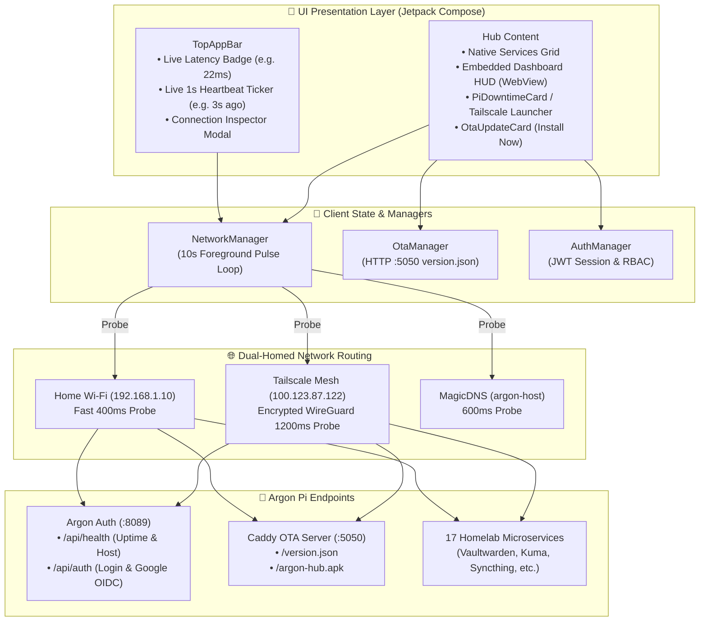
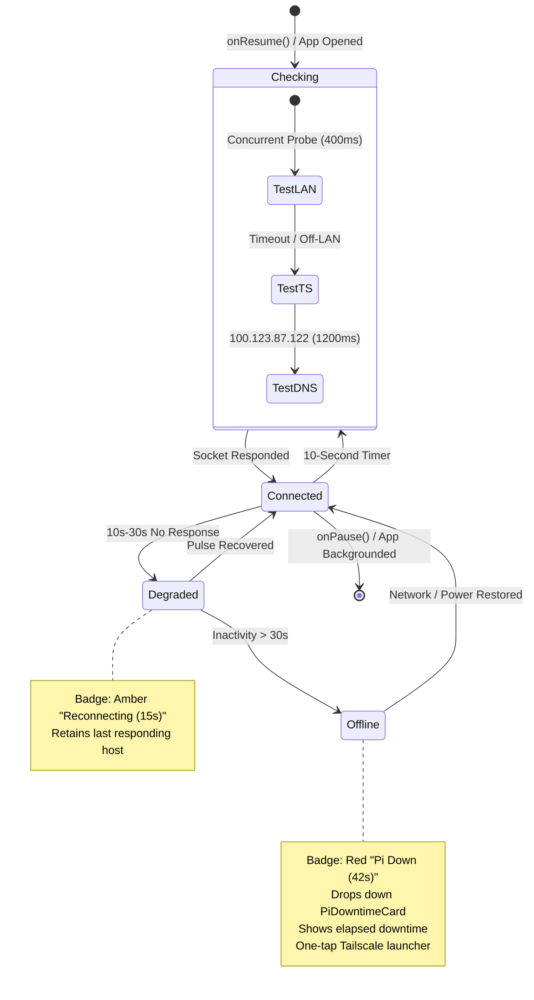
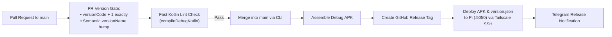

# Argon Mobile Hub v2.1 (Android)

Native Kotlin & Jetpack Compose Android companion client for the Raspberry Pi homelab (`argon-host`), featuring dual-homed network discovery, live foreground heartbeat monitoring, and over-the-air (OTA) updates.

---

## 🏛️ Mobile Architecture & Connection Pipeline



---

## 💓 Active Foreground Heartbeat State Machine

To provide instant visibility when the Pi reboots or loses power without battery drain, `NetworkManager` runs an active 10-second heartbeat while the app is in the foreground (pausing when backgrounded).



---

## 🚀 Key Features

1. **Live Heartbeat Ticker & Downtime Detection**:
   - **Real-Time Pulse Counter**: Ticks up every single second (`1s ago`, `2s ago`...) right under the title: `🟢 Last ping: 3s ago (healthy)`, resetting to `0s ago` when each 10s heartbeat arrives.
   - **Compact Latency Badge**: Displays active network mode and latency (e.g. `Tailscale Mesh • 22ms` or `Home Wi-Fi • 4ms`).
   - **One-Tap Inspector Modal**: Tap the badge to inspect IP address, latency, heartbeat interval, and dead-man's switch status.
   - **Smart Downtime Alert**: If unreachable for > 30 seconds, displays a warning card with exact elapsed downtime and quick actions to launch the Tailscale app or retry.

2. **Automated Over-The-Air (OTA) Updates**:
   - App automatically probes `:5050/version.json` on launch and refresh.
   - Compares remote build code with local package version.
   - In-app **Install Now** card with live progress bar and direct Android `PackageInstaller` integration.

3. **Auto-Endpoint Routing (Zero Pi Config)**:
   - Prioritizes Home Wi-Fi (`192.168.1.10`) for lowest latency when at home.
   - Automatically fails over to Tailscale (`100.123.87.122` / `argon-host`) when off-network.
   - Auto-reprobes network upon returning to foreground (`onResume`).

4. **Native Material Design 3 Experience**:
   - Modern dark UI matching Argon homelab styling.
   - Categorized card grid for all homelab services:
     - **Homepage Dashboard** (Port 80)
     - **Identity & User Portal** (Port 8089)
     - **AdGuard Home** (Port 8080)
     - **Uptime Kuma** (Port 3001)
     - **Vaultwarden Password Vault** (Port 8443, HTTPS with internal TLS trust)
     - **Stirling-PDF** (Port 8086)
     - **Syncthing** (Port 8384)
     - **Docker Registry UI** (Port 5001)
     - **Chromium Sandbox / Neeko** (Port 3002)
     - **Qdrant Vector DB** (Port 6333)
     - **CrowdSec Bouncer** (Port 8081)
     - **Cowrie Honeypot** (Port 2222)
     - **PairDrop & IT-Tools**
   - Dual Modes:
     - **Native Hub**: Individual service cards with launch & external browser shortcuts.
     - **Dashboard (HUD)**: Embedded full Homepage dashboard directly in-app.

5. **Unified Authentication & Role-Based Access Control (RBAC)**:
   - Full support for Username/Password and Google OIDC authentication against `argon-auth` (Port 8089).
   - Role-based UI filtering:
     - **Admin**: Unrestricted access to all infrastructure stacks + 1-tap shortcut to the **Identity & User Management Portal**.
     - **Standard User**: Clean view of daily productivity tools (Stirling-PDF, Syncthing, IT-Tools, PairDrop, Disposable Browser).
   - Top-bar profile menu with role badge (`ADMIN` / `USER`) and sign-out.
   - Offline / Guest access mode fallback.

---

## 🛠️ CI/CD Pipeline & Automated Releases



### Branch & PR Workflow Convention
1. Create a feature branch from `main`:
   ```bash
   git checkout -b feat/your-feature
   ```
2. Make Android changes, commit, and push:
   ```bash
   git push -u origin feat/your-feature
   ```
3. Open a Pull Request to `main`. GitHub Actions runs the **PR Version Gate** (`versionCode + 1` and semver bump) and fast compilation check.
4. On merging the PR into `main`:
   - Builds the APK
   - Creates a GitHub Release with the downloadable `.apk` file attached
   - Automatically syncs the new version to the Pi's OTA server (`argon-ota/dist/`) via Tailscale SSH!
   - Sends a Telegram release alert.

---

## Building Locally

```bash
JAVA_HOME=$HOME/.local/share/jdk-17/Contents/Home ANDROID_HOME=$HOME/Library/Android/sdk ./gradlew assembleDebug
```
